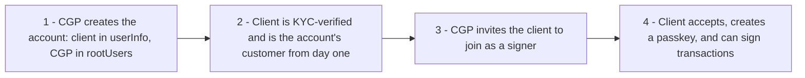
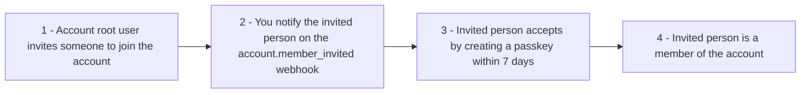
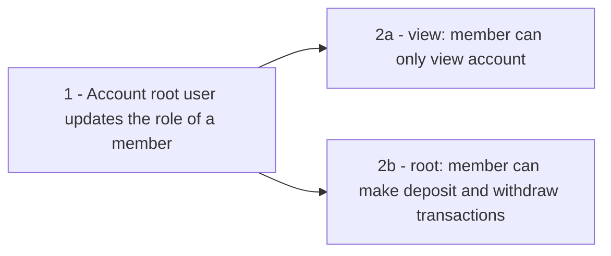

Multi-users account covers accounts with several signers, inviting users to an existing account, updating their roles, removing them, and allowing them to create their own passkeys.

## Which accounts can have multiple users

Both entity and individual accounts can have more than one signer (`root` user), each controlling the account with their own passkey:

- **Entity accounts** are multi-user by design: each root user and each beneficiary/representative is a separate person. Someone can be a signer without being a UBO, and a UBO without being a signer.
- **Individual accounts** can now also have several signers. Every signer is listed in the `rootUsers` field of the [create-individual-account](/api-reference/kyc) call, mirroring how entity accounts are created.

<Info>
  On any account, `userInfo` / `entityInfo` describes **who is being verified** (the customer), while `rootUsers` describes **who can sign**. For a standard individual account these are the same person; the sections below cover the cases where they differ.
</Info>

## Creating an account on behalf of a client

A wealth manager / CGP can create and manage an individual account for a client. This relies on the split between the verified customer and the signer:

- **`userInfo`** - the client. They are the KYC subject and appear as the account's customer from the moment it is created.
- **`rootUsers`** - the signer(s), for example the wealth manager, who control the account with their own passkeys.

The client is the account's customer immediately, even before they sign anything. When they are ready to take part in signing, invite them with the standard [invitation flow](#accepting-an-invitation) below. Once they accept and create a passkey, they become a signer (or `root` user) alongside the CGP.

<Tip>
  To hand over full control, the client (once a `root` signer) can demote the CGP to a `view` user by [updating roles](#promoting-and-demoting-roles-of-a-member). This leaves the client in control while the CGP keeps only the access you agree on.
</Tip>

## High-level flows

### Invitation-to-account

### Updating roles

## Technical implementation

### Inviting users

1. **Get invite users payload** - Request the payload that authorizes the invitation of new users to the account. Nothing is created yet. Use this endpoint to get the payload:

<Card
  title="Get invite users payload"
  icon="plus"
  horizontal
  href="/api-reference/account-management/step-1-get-invite-users-payload-passkey-or-wallet"
></Card>

2. **Submit the signed payload** - Then call the below endpoint with the signed payload to execute the invitations:

<Card
  title="Invite users to a account"
  icon="plus"
  horizontal
  href="/api-reference/account-management/step-2-send-invitations-passkey-or-wallet"
></Card>

What you sign, and what happens to the invited users, depends on the account:

| Account | Step 1 returns | Step 2 sends | Invited users |
| --- | --- | --- | --- |
| Passkey (Turnkey) | `bodyToSign` | `signedBody` (the `bodyToSign`) and `webAuthnStamp`, stamped by a root user's passkey, with `invitedBy` | Receive a `pending` invitation with the `view` role, to accept within 7 days (see below). |
| Self-custodial | `typedData` and `issuedAt` | The same `accountId` and `newUsers`, the account wallet signature of `typedData` (`walletSignature`, `eth_signTypedData_v4`) and `issuedAt`, with `invitedBy` | Join the account right away with the `self_custodial` role. |

For a self-custodial account, `chain_id` selects the chain the signed intent is bound to (`1` for Ethereum, `8453` for Base, Ethereum by default) and must be the same in both steps.

<Warning>
  Byzantine does not send any invitation email. Each invitation emits the `account.member_invited` [webhook event](/api-reference/webhooks/accounts): notify the invited person from it, with the link to your own sign-up or acceptance page. `account.member_joined` tells you when they have joined.
</Warning>

### Accepting an invitation

1. **Initialize OTP for a user** - Initialize an OTP for the invited person to authenticate by calling this endpoint:

<Card
  title="Initialize OTP for a user"
  icon="plus"
  horizontal
  href="/api-reference/otp-authentication/step-1-initialize-otp-send-email"
></Card>

2. **Authenticate with OTP** - The invited user enters the OTP code they received by email. Call this endpoint to authenticate them and open an OTP session:

<Card
  title="Authenticate with OTP code and create a session"
  icon="plus"
  horizontal
  href="/api-reference/otp-authentication/step-2-authenticate-with-otp-code"
></Card>

3. **Create a passkey and accept the invitation** - The invited user creates their passkey with the below endpoint, using the OTP session from steps 1 and 2. This is what accepts the invitation: until then, it stays `pending` and expires after 7 days.

<Card
  title="Create authenticators"
  icon="plus"
  horizontal
  href="/api-reference/otp-authentication/step-3-create-passkeys-otp-auth"
></Card>

<Note>
  The OTP code is the only email sent, by our wallet provider. A user invited with a passkey already attached, or invited to a self-custodial account, joins right away and skips these steps.
</Note>

Once an invitation is no longer `pending` (rejected, cancelled or expired), these three endpoints return `409` for that user on that account.

### Following, resending and rejecting invitations

An invitation is `pending` for 7 days, until `expires_at`. It then ends in exactly one of these statuses:

| Status | When | Webhook event |
| --- | --- | --- |
| `accepted` | The invited person accepted it (step 3 above). | `account.member_joined` |
| `rejected` | You rejected it on behalf of the invited person. | `account.invitation_rejected` |
| `cancelled` | It was replaced by a resent invitation, or the user was removed from the account. | `account.invitation_cancelled` |
| `expired` | It was not accepted within 7 days. | `account.invitation_expired` |

Invitations can be listed per account or per email via the [get-invitations-by-account-id](/api-reference/account-management/list-invitations-by-account) and [get-invitations-by-email](/api-reference/account-management/list-invitations-by-email) endpoints. `expires_at` is returned for a `pending` or `expired` invitation.

- **Resend an invitation** - Invite again a user who rejected their invitation, let it expire, or has not answered yet. A new `pending` invitation with a new 7-day window is created on behalf of the same inviter, and emits `account.member_invited` again; a still pending one is cancelled. No passkey stamp is needed, so it is up to you to decide who may trigger it. It returns `409` when the user already joined, was removed from the account (invite them again with the flow above), has a more recent invitation, or when the original inviter is no longer a root user.

<Card
  title="Resend an invitation"
  icon="paper-plane"
  horizontal
  href="/api-reference/account-management/resend-an-invitation"
></Card>

- **Reject an invitation** - Decline a `pending` invitation on behalf of the invited person, for example when they decline it in your interface. It can no longer be accepted.

<Card
  title="Reject an invitation"
  icon="xmark"
  horizontal
  href="/api-reference/account-management/reject-an-invitation"
></Card>

### Promoting and demoting roles of a member

- **Get update users role payload** - Request the payload that the root user must sign to change users’ roles. Call this endpoint:

<Card
  title="Get update users role payload"
  icon="plus"
  horizontal
  href="/api-reference/account-management/step-1-get-update-role-payload-passkey"
></Card>

- **Submit the signed payload** - Then call the below endpoint with the signed payload to execute the role update:

<Card
  title="Update users' role"
  icon="plus"
  horizontal
  href="/api-reference/account-management/step-2-update-users-role-passkey"
></Card>

<Note>
  Roles can only be updated on passkey (Turnkey) accounts: a role change updates the root quorum. A self-custodial account has its wallet as only signer and all its members carry the `self_custodial` role, so these endpoints return `400` for it.
</Note>

### Removing users

1. **Get remove users payload** - Request the payload that authorizes the removal, with the `userIds` to remove. Nothing is removed yet.

<Card
  title="Get remove users payload"
  icon="user-minus"
  horizontal
  href="/api-reference/account-management/step-1-get-remove-users-payload-passkey-or-wallet"
></Card>

2. **Submit the signed payload** - Then call the below endpoint with the signed payload. On a passkey account, send `signedBody` and `webAuthnStamp`: the root user whose passkey stamped it is the remover. On a self-custodial account, send the same `accountId` and `userIds` (in the same order), the account wallet signature of `typedData` (`walletSignature`) and `issuedAt`, on the same `chain_id`.

<Card
  title="Remove users"
  icon="user-minus"
  horizontal
  href="/api-reference/account-management/step-2-remove-users-passkey-or-wallet"
></Card>

Some rules apply, whatever the account:

- A `root` user cannot be removed: demote them to `view` first.
- The account's KYC subject and the beneficiaries of an entity account (UBOs, directors) stay on the account with the `beneficiary` role: only their access is revoked (passkeys, OTP sessions). The response reports them with the `access_revoked` outcome, and the others with `removed`.
- A self-custodial account must keep at least one member.
- A pending invitation of a removed user is cancelled.

Each removed member emits `account.member_removed`, and each member who keeps the `beneficiary` role emits `account.member_role_updated`.

## Roles and permissions

Four different roles exist:

- `root`: The root user is the admin of the account and has full permissions.
- `view`: The view user can only view the account and cannot make any transactions.
- `beneficiary`: Beneficiary users are the associated persons of an entity account (UBO, representative, director or signer) at the moment of creation. By default, they cannot make any transactions. Being declared a `signer` in the KYB is a compliance declaration, not the `root` signing role.
- `self_custodial`: All accounts created with a self-custodial wallet have this role.

The roles and permissions are described in the table below:

| Role             | Can view | Can deposit & withdraw | Can manage users | Can add bank accounts |
| :--------------- | :------- | :--------------------- | :--------------- | :-------------------- |
| `root`           | ✅       | ✅                     | ✅               | ✅                    |
| `view`           | ✅       | ❌                     | ❌               | ❌                    |
| `beneficiary`    | ✅       | ❌                     | ❌               | ❌                    |
| `self_custodial` | ✅       | ✅                     | ✅ (with the account wallet) | ✅                    |
