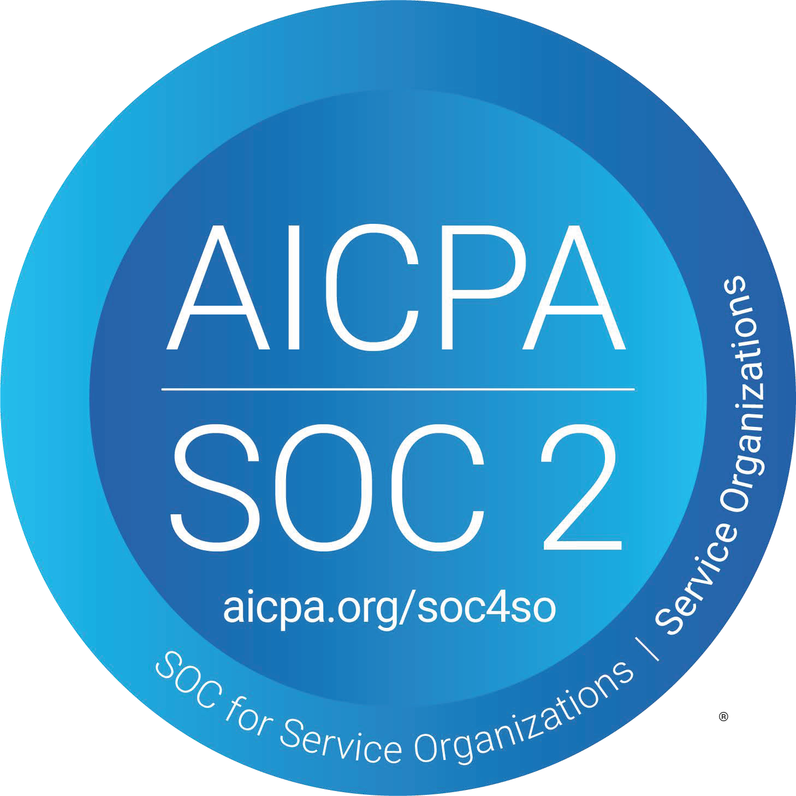

Byzantine Finance has completed a SOC 2 Type 2 examination of its security controls, covering the Security criteria over the period June 1 to August 31, 2026. The report was issued by Sentry Assurance on November 6, 2026.

## What a SOC 2 report is

System and Organization Controls (SOC) reports are examinations of a company's controls, performed by an independent CPA firm under the attestation standards of the AICPA. The report describes the system, the controls and the tests the auditor performed. A SOC 2 report covers the controls relevant to one or more Trust Services Criteria: security, availability, processing integrity, confidentiality and privacy.

- A **Type 1** report assesses whether controls are suitably designed at a given date.
- A **Type 2** report also tests whether those controls operated effectively throughout a period of time.

Learn more about SOC reports on the [AICPA website](https://www.aicpa.org/soc4so).

## Our report

| | |
| --- | --- |
| Report type | SOC 2 Type 2 |
| Service auditor | Sentry Assurance, LLC |
| Report date | November 6, 2026 |
| Period covered | June 1, 2026 to August 31, 2026 |
| Trust Services Criteria | Security |
| Renewal | Annual |

## What it covers

The examination covers the Byzantine platform and the infrastructure that runs it: the web application, the backend APIs, the databases and the indexer, together with the internal processes of the team that operates them. The controls examined relate to:

- access to systems restricted by role, so that each person only reaches the information their job requires
- intrusion detection and vulnerability scanning of external-facing systems
- procedures for managing and communicating security incidents
- encryption of customer data at rest and in transit
- retention and disposal of data
- availability monitoring of production systems

## What it does not cover

- **Smart contracts and the vault.** Their code is reviewed separately by independent security firms: see [Security audits](/documentation/asset-protection/security-audits).
- **Cloud providers.** Byzantine runs on Amazon Web Services, Supabase and Vercel. Their own controls are assumed by the report but are not part of our examination.
- **Third-party partners**, such as the strategy curator, custodians, the fiat on-ramp and off-ramp partner, and the decentralised protocols.

## How to request the report

A SOC 2 report is a restricted-use document. Clients and prospective clients can request a copy, under a non-disclosure agreement, by writing to [info@byzantine.fi](mailto:info@byzantine.fi) with your company name and your relationship with Byzantine (client or prospective client).
