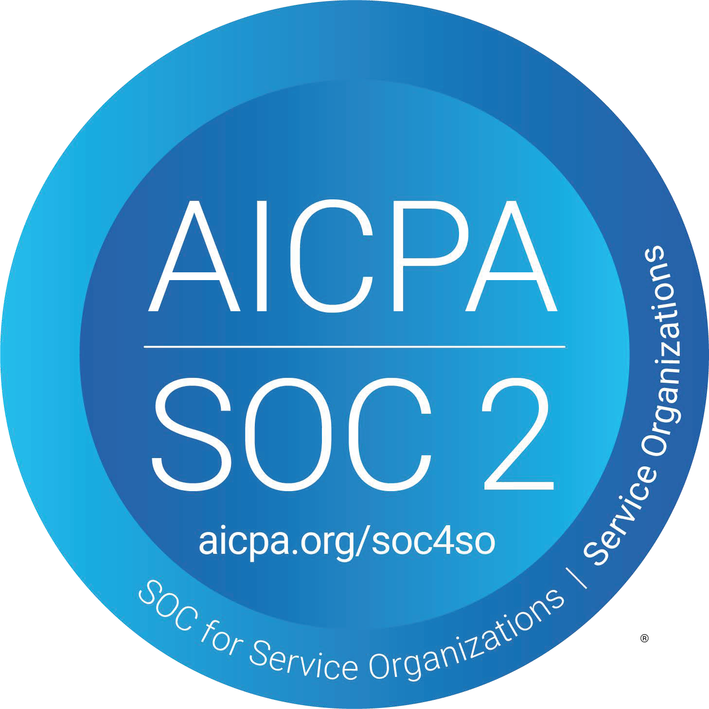

Byzantine Finance a finalisé un examen SOC 2 Type II de ses contrôles de sécurité, portant sur le critère Sécurité, sur la période du 1er juin au 31 août 2026. Le rapport a été émis par Sentry Assurance le 6 novembre 2026.

## Qu'est-ce qu'un rapport SOC 2

Les rapports SOC (System and Organization Controls) sont des examens des contrôles d'une entreprise, réalisés par un cabinet d'experts-comptables indépendant selon les normes d'attestation de l'AICPA. Le rapport décrit le système, les contrôles et les tests réalisés par l'auditeur. Un rapport SOC 2 porte sur les contrôles liés à un ou plusieurs Trust Services Criteria : sécurité, disponibilité, intégrité du traitement, confidentialité et vie privée.

- Un rapport **Type I** évalue si les contrôles sont correctement conçus à une date donnée.
- Un rapport **Type II** vérifie en plus que ces contrôles ont fonctionné efficacement sur toute une période.

Pour en savoir plus sur les rapports SOC, consultez le [site de l'AICPA](https://www.aicpa.org/soc4so).

## Notre rapport

| | |
| --- | --- |
| Type de rapport | SOC 2 Type II |
| Auditeur | Sentry Assurance, LLC |
| Date du rapport | 6 novembre 2026 |
| Période couverte | du 1er juin 2026 au 31 août 2026 |
| Trust Services Criteria | Sécurité |
| Renouvellement | Annuel |

## Ce qu'il couvre

L'examen porte sur la plateforme Byzantine et l'infrastructure qui la fait fonctionner : l'application web, les API backend, les bases de données et l'indexeur, ainsi que les processus internes de l'équipe qui les opère. Les contrôles examinés concernent :

- l'accès aux systèmes limité selon le rôle, afin que chaque personne n'accède qu'aux informations nécessaires à sa fonction
- la détection d'intrusion et les scans de vulnérabilité des systèmes exposés
- les procédures de gestion et de communication des incidents de sécurité
- le chiffrement des données clients au repos et en transit
- la conservation et la suppression des données
- la surveillance de la disponibilité des systèmes de production

## Ce qu'il ne couvre pas

- **Les smart contracts et le vault.** Leur code est examiné séparément par des cabinets de sécurité indépendants : voir [Audits de sécurité](/fr/documentation/asset-protection/security-audits).
- **Les fournisseurs cloud.** Byzantine fonctionne sur Amazon Web Services, Supabase et Vercel. Le rapport suppose que leurs propres contrôles sont en place, mais ils ne font pas partie de notre examen.
- **Les partenaires tiers**, comme le curateur de stratégie, les dépositaires, le partenaire d'entrée et de sortie fiat et les protocoles décentralisés.

## Comment demander le rapport

Un rapport SOC 2 est un document à usage restreint. Les clients et les prospects peuvent en demander une copie, sous accord de confidentialité, en écrivant à [info@byzantine.fi](mailto:info@byzantine.fi), en indiquant le nom de votre société et votre relation avec Byzantine (client ou prospect).
